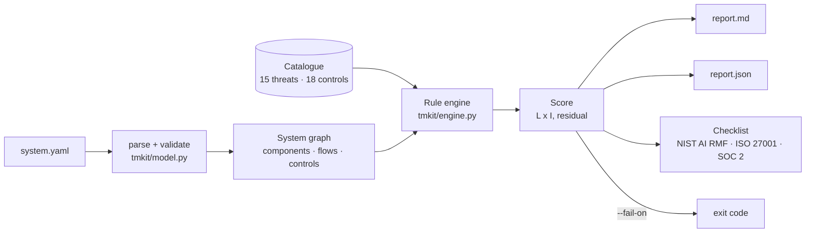

# llm-threat-model-kit

A threat-model generator for LLM and agentic applications. Describe the system in YAML (components, data flows, tool permissions, data sensitivity, controls already in place). The kit returns threats tagged with **STRIDE**, the **OWASP Top 10 for LLM Applications (2025)** and **MITRE ATLAS**, scores inherent and residual risk, and prints a control checklist mapped to **NIST AI RMF 1.0**, **ISO/IEC 27001:2022 Annex A** and **SOC 2** criteria. It ships with three worked examples: an AI agency stack where agents have email and CRM access, the same stack after hardening, and a public RAG chatbot. Part of a security-engineering portfolio.

## What it is
- **Input:** a YAML file. Component types: `user`, `llm`, `agent`, `tool`, `datastore`, `vector_store`, `retriever`, `external_source`, `external_api`, `model_registry`, `orchestrator`. Tools declare `actions` (`read/write/send/execute/pay/delete/browse`) and `human_approval`. Flows can set `untrusted_content`.
- **Catalogue:** 15 threats (T01–T15) covering all 10 OWASP LLM 2025 items, plus 18 controls (C01–C18). See [`tmkit/catalog.py`](tmkit/catalog.py).
- **Output:** Markdown + JSON report (threat table, evidence for each threat, control checklist). `--fail-on High` exits 1 when any *residual* risk is High or worse, so the kit can gate a design review in CI.

## Why
Generic STRIDE sessions miss agent-specific failure modes: an inbox that feeds instructions to an agent with a `send` tool, or a vector store that mixes public forum posts with confidential case notes. This kit encodes those patterns as rules over the system graph. Each finding names the edge or component that triggered it, so a reviewer can argue with the evidence instead of a vague label.

## Architecture


## How it works
1. **Rules.** Each threat has an `applies(model)` predicate that returns evidence or nothing. Examples: T02 fires when a non-user flow marked untrusted (or from an untrusted source) reaches an LLM, agent, retriever or vector store. T03 fires on any write/send/pay/delete/execute tool without `human_approval`. T04 fires only when three things meet: confidential data reaches the model, an outbound channel exists, and untrusted or user input can steer the model.
2. **Inherent score** = likelihood × impact (1–5 each). Base values come from the catalogue. Likelihood +1 if any component is public, and +1 more for injection-driven threats when untrusted content reaches the model. Impact follows data sensitivity for disclosure threats, and +1 for action threats when an unapproved tool can pay, delete, send or execute. Critical ≥ 15, High ≥ 10, Medium ≥ 5.
3. **Residual score.** Each listed mitigation already in `controls_in_place` lowers likelihood by one (floor 1). Impact does not change: controls make the bad event rarer, not smaller.
4. **Checklist.** Every control that mitigates a raised threat, with in-place/MISSING status, the threats it covers, a priority (highest inherent score it addresses), and its framework references.

## Results
Generated 2026-11-10 by `python -m tmkit examples/<x>.yaml -o reports`. Full reports: [`reports/`](reports/).

| Example | Threats | Inherent (C/H/M/L) | Residual (C/H/M/L) | Total score inherent → residual | Controls in place / missing | OWASP LLM items raised |
|---|---|---|---|---|---|---|
| [AI agency client-ops agents](reports/ai-agency-stack.md) | 12 | 5 / 1 / 6 / 0 | 3 / 2 / 6 / 1 | 148 → 121 | 3 / 13 | LLM01, 02, 03, 05, 06, 07, 09, 10 |
| [Same stack, hardened](reports/ai-agency-stack-hardened.md) (+C02–C07) | 12 | 5 / 1 / 6 / 0 | 0 / 1 / 8 / 3 | 148 → 73 | 9 / 7 | same |
| [Public RAG support chatbot](reports/rag-chatbot.md) | 10 | 3 / 7 / 0 / 0 | 2 / 2 / 6 / 0 | 132 → 103 | 4 / 11 | LLM01, 02, 03, 04, 07, 08, 09, 10 |

Top findings for the agency stack (as generated):

| ID | Threat | Evidence | Inherent | Residual (as-is) | Residual (hardened) |
|---|---|---|---|---|---|
| T02 | Indirect prompt injection | `orchestrator -> triage_agent` carries raw client email | 25 Critical | 25 Critical | 10 High |
| T04 | Data exfiltration | CRM data in context + `email_send` tool | 16 Critical | 16 Critical | 4 Low |
| T07 | Improper output handling | model output drives `calendar`, `crm_write` | 15 Critical | 15 Critical | 5 Medium |
| T03 | Excessive agency | `calendar`, `crm_write`, `email_send` without approval | 15 Critical | 10 High | 5 Medium |

Reading it: the agency's 3 existing controls (no secrets in prompts, logging, strong auth) cut the total score by only 27 points, because none of them touch the inbox → agent → `send` path. Adding the six controls on that path (C02–C07) removes every Critical. One High remains: T02 still needs C01 (injection detection). `--fail-on High` therefore still exits 1 for both agency variants.

Tests: **27 passed** ([`reports/pytest-summary.txt`](reports/pytest-summary.txt)). They cover catalogue integrity (all 10 OWASP items covered, every control used and mapped), 6 schema errors, rule triggers and non-triggers, scoring bands and modifiers, residual floors, the worked examples, determinism, committed reports matching the current engine, and CLI exit codes.

## Run it
```bash
python3 -m venv .venv && .venv/bin/pip install -r requirements.txt
.venv/bin/python -m tmkit examples/ai-agency-stack.yaml            # Markdown to stdout
.venv/bin/python -m tmkit examples/rag-chatbot.yaml -o reports     # .md + .json
.venv/bin/python -m tmkit my-system.yaml --fail-on High            # CI gate
.venv/bin/pytest -q
```

## Limits / scope
- **Mappings are engineering judgement, not an official crosswalk.** OWASP, ATLAS, NIST AI RMF, ISO 27001 and SOC 2 references were written from the public framework documents. They were not machine-checked against the live ATLAS matrix or the AICPA text in this build. Check current IDs before you cite them in an audit. ISO 27001 has no direct control for misinformation (C15), and the report says so.
- Scores are heuristic and ordinal. They rank work; they are not probabilities or loss estimates.
- The residual model is simple: each control is −1 likelihood regardless of strength or how well it is run. A real assessment tests the control (see C14).
- The rules see only what the YAML declares. An undeclared tool or data flow produces no threat.
- Both worked examples are fictional systems. No client data is used.

## License
MIT
